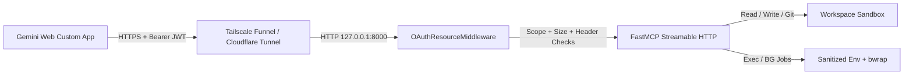

**English** | [简体中文](README.zh-CN.md)

# Gemini Remote Agent MCP

A workspace-scoped remote development MCP server built for **Gemini Custom Apps / MCP Connectors**. It exposes 12 standard tools directly inside a target workspace over stateless Streamable HTTP, secured with OAuth 2.1 + PKCE, path sandboxing, secret redaction, and JSONL audit logging.



## Features & Security Controls

- **Files**: `list_directory`, `find_files`, `grep_search` (ripgrep), `read_file` (line-numbered), `edit_file` (SHA-256 optimistic lock + unified diff), `write_file` (atomic write).
- **Execution**: `run_command`, `start_bg_job`, `poll_bg_job`, `kill_bg_job` with process-tree termination and concurrency limits.
- **Git**: `git_status_diff`, `git_restore` (disabled by default, requires explicit confirmation).
- **Hardening**:
  - Case-insensitive `denied_globs`, symlink/junction traversal blocking, Windows reserved device name & ADS checks, and ripgrep glob-override protection.
  - Child-process environment scrubbing (`MCP_*`, `AWS_*`, `GITHUB_TOKEN`, `*SECRET*`, `*TOKEN*`, etc.), command policy checks, and optional command allowlist (`MCP_ALLOWED_COMMANDS`).
  - OAuth 2.1 + PKCE (`S256`) resource server & optional self-hosted single-user provider with rate limiting, CSP-hardened consent UI, security headers, streaming body size limit, and rotating JSONL audit logs.

## Quick Start

### Local Development

```bash
cp .env.example .env
# Set MCP_WORKSPACE_ROOT, and for local testing set MCP_AUTH_ENABLED=false, MCP_SANDBOX_MODE=none
uv sync
uv run remote-agent-mcp --check
uv run remote-agent-mcp                      # Streamable HTTP (Gemini Web / remote)
uv run remote-agent-mcp --transport stdio    # Stdio (Gemini CLI / Claude Desktop / Cursor)
uv run remote-agent-mcp --print-client-config gemini-cli
```

### Docker (Isolated Non-Root Container)

```bash
docker build -t gemini-remote-agent-mcp .
docker run --rm -p 127.0.0.1:8000:8000 \
  -v /path/to/project:/workspace \
  -e MCP_AUTH_ENABLED=true \
  -e MCP_OAUTH_ISSUER=https://YOUR_TENANT.us.auth0.com/ \
  -e MCP_OAUTH_AUDIENCE=https://mcp.example.com/mcp \
  -e MCP_ALLOWED_USER_SUBS=auth0|YOUR_SUBJECT \
  gemini-remote-agent-mcp
```

### Verification

```bash
uv run ruff check .
uv run pytest
npx @modelcontextprotocol/inspector
```

## Documentation

- [`docs/SECURITY.md`](docs/SECURITY.md) — Production deployment checklist and incident response.
- [`docs/CLIENTS.md`](docs/CLIENTS.md) — Setup for **Gemini Web** (with [KenEasy-Gemini-MCP-Auto-Helper](https://github.com/ngiken/KenEasy-Gemini-MCP-Auto-Helper) + server circuit breaker), **Gemini CLI**, **Claude Desktop**, and **Cursor**.
- [`docs/PLAN.md`](docs/PLAN.md) — Architecture boundaries and acceptance criteria.
